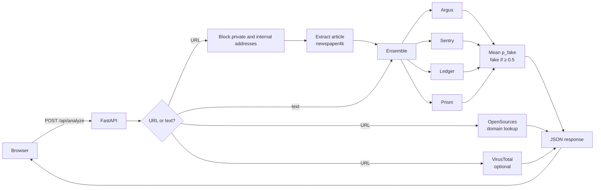
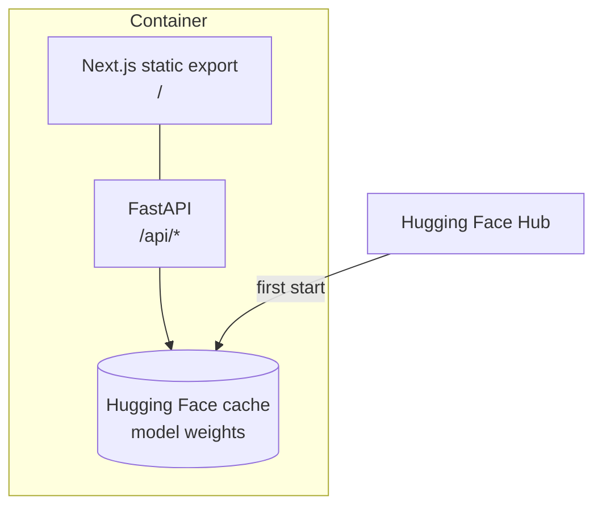
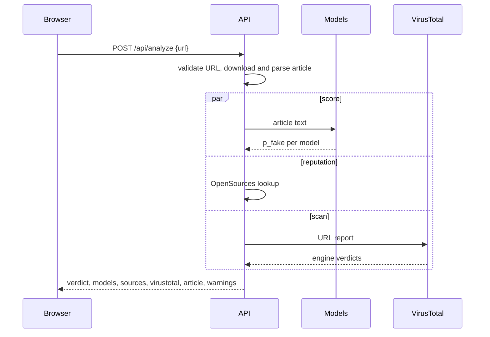
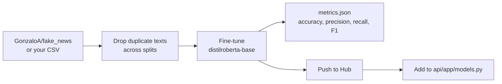

# Loki

Loki estimates whether a news article reads as fake. Paste a link or the article text. Four transformer classifiers each score the text, and Loki averages their scores. For links, it also checks the site's reputation and scans the URL with VirusTotal.

The result is a statistical signal about the text, not a fact-check.

## Architecture



One container serves both the API and the static Next.js site on port 7860.



## Request flow



## Models

Each model outputs the probability that the text is fake. Long texts are split into overlapping 512-token windows, and each model averages its score across them. Loki averages the four models with equal weight.

| Name | Architecture | Trained on |
|---|---|---|
| Argus | RoBERTa-base | Kaggle Fake and Real News (ISOT) |
| Sentry | RoBERTa-base | 40,000+ articles from mixed outlets |
| Ledger | RoBERTa-base | EUvsDisinfo disinformation cases |
| Prism | DistilBERT | Mixed real and fake news articles |

The models are pulled from the Hugging Face Hub on first start. `api/app/models.py` lists the source repo for each one. Use `ENABLED_MODELS` to switch models on or off.

## Project layout

```
api/        FastAPI backend: models, article extraction, domain lookup, VirusTotal
web/        Next.js frontend (static export, motion, pretext)
training/   Fine-tuning script for your own models
Dockerfile  Builds the web app, then the Python runtime that serves both
```

## Run locally

With Docker:

```bash
cp .env.example .env        # optional: add VIRUS_TOTAL_API_KEY
docker compose up --build
```

Then open http://localhost:7860. The first start downloads about 1.8 GB of models.

Without Docker:

```bash
# backend
cd api
pip install torch --index-url https://download.pytorch.org/whl/cpu
pip install -r requirements.txt
uvicorn app.main:app --reload --port 8000

# frontend (second terminal)
cd web
npm install
NEXT_PUBLIC_API_URL=http://localhost:8000 npm run dev
```

Run the tests:

```bash
cd api && pip install -r requirements-dev.txt && pytest -q
```

## Configuration

| Variable | Purpose |
|---|---|
| `VIRUS_TOTAL_API_KEY` | Turns on URL scanning |
| `HF_TOKEN` | Optional. Raises Hugging Face Hub rate limits |
| `ENABLED_MODELS` | Comma-separated model ids. Default `argus,sentry,ledger,prism` |
| `CORS_ORIGINS` | Allowed origins for local frontend dev |

## Deploy to Hugging Face Spaces

The front matter at the top of this README configures the Space (`sdk: docker`, `app_port: 7860`).

```bash
hf auth login
hf repo create <user>/loki --repo-type space --space-sdk docker
git remote add space https://huggingface.co/spaces/<user>/loki
git push space main
```

Add `VIRUS_TOTAL_API_KEY` under the Space's Settings → Secrets if you want URL scanning. The free CPU tier is enough.

## Train your own model



```bash
pip install torch --index-url https://download.pytorch.org/whl/cu124
pip install -r training/requirements.txt
python training/train.py --sample 200 --epochs 1 --max-length 128   # quick check
python training/train.py --push-to-hub <user>/loki-distilroberta     # full run
```

Saved models always use `0 = FAKE, 1 = REAL`, so a trained model goes into `api/app/models.py` with fake index `0`. The defaults (batch size 4, gradient accumulation 4, fp16, gradient checkpointing) are sized for a 4 GB GPU.

## Limits

- Classifiers learn writing style from their training sets. Satire, opinion pieces and breaking news are common sources of error.
- Domain reputation only covers the 825 sites in the OpenSources list.
- Article extraction fails on paywalled or script-rendered pages. Paste the text instead.
